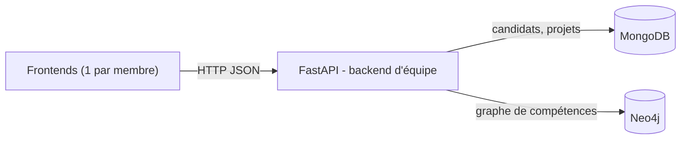
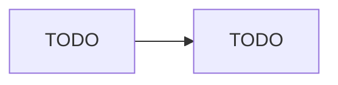

# 🧠 ARCHITECTURE - Équipe `TODO-nom-equipe`

> **Jalon 1** : ce document est votre **spécification**. Il doit être **complet** : toute l'équipe va coder dessus.
> Toutes les sections sont obligatoires. Remplacez **tous** les `TODO` (la CI « Livrables » les compte).
> En soutenance (5 à 6 min), vous présenterez surtout la **section 1** (schéma) et le contrat `API_ROUTES.md`.

## 1. Schéma d'architecture

Montrez **qui stocke quoi** et **quels flux** : frontends → API → MongoDB / Neo4j.

**Recommandé : [Excalidraw](https://excalidraw.com)** (à plusieurs via *Live collaboration*). Exportez en PNG ou SVG avec **« Embed scene »** coché,
enregistrez dans `docs/architecture.excalidraw.png`, puis remplacez le schéma Mermaid ci-dessous par :

``

L'image reste modifiable : rouvrez-la dans Excalidraw (ou dans VS Code avec l'extension *Excalidraw*).



TODO : en 3 à 5 lignes, le rôle de chaque base dans votre portfolio.

## 2. Les requêtes à servir

| # | Besoin (vu par un recruteur) | Route API | Base(s) interrogée(s) |
|---|---|---|---|
| R1 | Profil + timeline (expériences, formations) d'un candidat | `GET /api/candidats/{slug}` | MongoDB (candidats, un seul document) |
| R2 | Projets d'un candidat, filtrables par compétence | `GET /api/candidats/{slug}/projets` | MongoDB (projets, filtre indexé) |
| R3 | Statistiques d'un candidat par compétence | `GET /api/candidats/{slug}/stats` | MongoDB (pipeline d’agrégation) |
| R4 | Projets similaires à un projet | `GET /api/graph/projets/{slug}/similaires` | Neo4j, puis MongoDB pour les fiches |
| R5 | Graphe de compétences d'un candidat | `GET /api/graph/competences/{slug}` | Neo4j |
| R6 | Compétences transversales d’un candidat (utilisées dans plusieurs projets) | `GET /api/graph/candidats/{slug}/competences-transversales` | Neo4j |
| R7 |Derniers projets de l’équipe, triés par date| `GET /api/projets/recents` | MongoDB (index sur la date) |
| R8 | Preuves d’une compétence: projets et expériences qui la mobilisent | `GET /api/competences/{slug}/preuves` | Neo4j (slugs), puis MongoDB (contenu) |
| TODO | Vos requêtes supplémentaires | TODO | TODO |

## 3. Modèle MongoDB

### 3.1 Collection `candidats` - pattern TODO (*Embedding* ? *Referencing* ?)

```json
{
  "_id": "alice-martin",
  "candidat_slug": "alice-martin",
  "nom": "Martin",
  "prenom": "Alice",
  "titre": "Étudiante ingénieure en data, recherche une alternance",
  "bio": "Passionnée par les données et les architectures backend.",
  "contacts": {
    "email": "alice.martin@example.com",
    "github": "https://github.com/alice-martin",
    "linkedin": "https://linkedin.com/in/alice-martin"
  },
  "langues": [
    { "langue": "Français", "niveau": "Natif" },
    { "langue": "Anglais", "niveau": "C1" }
  ],
  "experiences": [
    {
      "type": "stage",
      "entreprise": "Acme Data",
      "poste": "Stagiaire data engineer",
      "debut": "2025-06-01",
      "fin": "2025-08-31",
      "description": "Mise en place d'un pipeline d'ingestion de données."
    },
    {
      "type": "alternance",
      "entreprise": "Normandie Tech",
      "poste": "Développeuse backend",
      "debut": "2026-09-01",
      "fin": null,
      "description": "Développement d'API REST en Python."
    }
  ],
  "formations": [
    {
      "ecole": "ESIGELEC",
      "diplome": "Diplôme d'ingénieur, majeure data",
      "debut": "2024-09-01",
      "fin": null
    },
    {
      "ecole": "Lycée Corneille",
      "diplome": "Baccalauréat scientifique",
      "debut": "2021-09-01",
      "fin": "2024-06-30"
    }
  ]
}
```

**Justification** (cardinalité bornée ou non, lecture en une requête, fréquence de mise à jour) : Les expériences, formations, langues et contacts sont bornés. Un candidat en a quelques-unes, rarement plus de 10 ou 20, donc le document reste très loin de la limite de 16 Mo. Ils sont toujours lus avec leur parent: R1 affiche le profil et la timeline, et une seule lecture suffit, sans jointure. Ils changent rarement, donc la mise à jour du document entier n’est pas un coût. Enfin, ils n’ont pas d’identité propre et ne sont pas partagés entre candidats: une expérience appartient à une seule personne. L’embedding est donc le bon choix. Les projets, eux, ne sont pas imbriqués dans le candidat (voir 3.2).

### 3.2 Collection `projets` - pattern TODO

```json
{
  "_id": "smartcity-explorer",
  "projet_slug": "smartcity-explorer",
  "titre": "SmartCity Explorer",
  "description": "Application de visualisation de données urbaines combinant MongoDB et Neo4j.",
  "type": "academique",
  "date_debut": "2026-01-15",
  "date_fin": "2026-03-30",
  "auteurs": ["alice-martin", "bob-durand"],
  "competences": [
    { "skill_slug": "python", "nom": "Python" },
    { "skill_slug": "mongodb", "nom": "MongoDB" },
    { "skill_slug": "fastapi", "nom": "FastAPI" }
  ],
  "liens": {
    "github": "https://github.com/nosql-esigelec/smartcity-explorer",
    "demo": null
  },
  "resultats": "Prototype fonctionnel présenté en soutenance."
}
```

**Justification** : Un projet est une entité autonome, et il peut avoir plusieurs auteurs (auteurs). L’imbriquer dans candidats forcerait à le dupliquer chez chaque auteur, avec le risque de versions qui divergent. Le nombre de projets peut aussi croître sans limite connue, et leur description est longue, ce qui fait grossir le document candidat. Une collection dédiée permet de filtrer par compétence (R2), de trier par date (R8) et d’agréger sur les compétences (R3). La liaison avec le candidat se fait par le slug: projets.auteurs contient des candidat_slug. On ne stocke donc pas de liste de projets dans candidats, ce qui évite d’avoir à maintenir les deux côtés cohérents.


### 3.3 Index

| Collection | Index | Requête servie (R#) |
|---|---|---|
| candidats | _id (= candidat_slug), créé automatiquement, unique | R1 |
| projets | _id (= projet_slug), créé automatiquement, unique |  R4 et R8 (récupérer les fiches à partir des slugs donnés par Neo4j) |
| projets | { auteurs: 1, date_debut: -1 } | R2 (projets d’un candidat, triés par date), R3 ($match sur l’auteur au début du pipeline) |
| projets | { "competences.skill_slug": 1 }| R2 (filtre par compétence), R8 |
| projets | { date_debut: -1 } | R7 (derniers projets de l’équipe) |


```javascript
db.projets.createIndex({ auteurs: 1, date_debut: -1 })
db.projets.createIndex({ "competences.skill_slug": 1 })
db.projets.createIndex({ date_debut: -1 })
```

### 3.4 Pipeline d'agrégation clé (R3)

```javascript
db.projets.aggregate([
  // 1. Ne garder que les projets du candidat (utilise l'index { auteurs: 1, date_debut: -1 })
  { $match: { auteurs: "alice-martin" } },

  // 2. Un document par couple (projet, compétence)
  { $unwind: "$competences" },

  // 3. Regrouper par compétence
  { $group: {
      _id: "$competences.skill_slug",
      nom: { $first: "$competences.nom" },
      nb_projets: { $sum: 1 },
      projets: { $push: "$projet_slug" },
      premiere_utilisation: { $min: "$date_debut" },
      derniere_utilisation: { $max: "$date_debut" }
  } },

  // 4. Les compétences les plus utilisées d'abord
  { $sort: { nb_projets: -1, _id: 1 } },

  // 5. Mise en forme de la sortie
  { $project: {
      _id: 0,
      skill_slug: "$_id",
      nom: 1,
      nb_projets: 1,
      projets: 1,
      premiere_utilisation: 1,
      derniere_utilisation: 1
  } }
])
```
Exemple de résultat (c’est ce que renverra GET /api/candidats/{slug}/stats):

```javascript
[
  {
    "skill_slug": "python",
    "nom": "Python",
    "nb_projets": 3,
    "projets": ["smartcity-explorer", "portfolio-nosql", "chatbot-rh"],
    "premiere_utilisation": "2025-09-10",
    "derniere_utilisation": "2026-01-15"
  },
  {
    "skill_slug": "mongodb",
    "nom": "MongoDB",
    "nb_projets": 2,
    "projets": ["smartcity-explorer", "portfolio-nosql"],
    "premiere_utilisation": "2026-01-15",
    "derniere_utilisation": "2026-01-15"
  }
]
```
## 4. Modèle Neo4j

### 4.1 Schéma du graphe



| Label | Propriétés | Clé unique |
|---|---|---|
| TODO | TODO | TODO |

| Relation | De → Vers | Propriétés | Pourquoi ce sens |
|---|---|---|---|
| TODO | TODO | TODO | TODO |

### 4.2 Les 3 requêtes Cypher clés

```cypher
// R4 - projets similaires
TODO

// R5 - graphe de compétences d'un candidat
TODO

// Compétences communes aux membres de l'équipe (ou requête de votre choix)
TODO
```

### 4.3 Contraintes

```cypher
TODO : CREATE CONSTRAINT ... IF NOT EXISTS
```

## 5. Cohérence entre les bases (slugs pivots)

| Entité | Slug | Dans MongoDB | Dans Neo4j |
|---|---|---|---|
| Candidat | `candidat_slug` (ex. `alice-martin`) | TODO | TODO |
| Projet | `projet_slug` (ex. `smartcity-explorer`) | TODO | TODO |
| Compétence | `skill_slug` (ex. `mongodb`) | TODO | TODO |

**Suppression d'un projet** : que faites-vous dans chaque base ? TODO

## 6. Répartition du travail

| Membre (pseudo GitHub) | Backend (couches / routes) | Frontend |
|---|---|---|
| TODO | TODO | `frontends/frontend-TODO/` |
